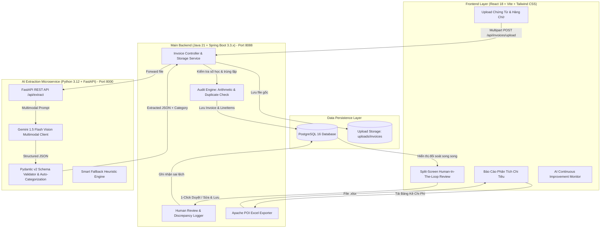

# Smart Expense Reimbursement & Invoice Audit
## Hệ Thống Tự Động Hóa Quyết Toán & Kiểm Toán Chi Phí Doanh Nghiệp

> **Ngôn ngữ & Nền tảng**: Java 21 Spring Boot + Python 3.12 FastAPI + Google Gemini Vision + PostgreSQL 16 + React 18 (Vite) + Tailwind CSS

---

## 1. Giới Thiệu Chung & Mục Tiêu Đề Tài

Hệ thống **Smart Expense Reimbursement & Invoice Audit** giải quyết toàn diện bài toán tự động hóa quy trình quyết toán chi phí cho doanh nghiệp, từ lúc nhân viên phát sinh chi phí và nộp hóa đơn, qua khâu trích xuất đa phương thức bằng AI Vision, kiểm toán số học & trùng lặp tự động, đối soát trực quan hai màn hình (Split-Screen Human-In-The-Loop), đến kết xuất bảng kê chi phí chuẩn kế toán và lưu vết sai lệch để liên tục cải tiến mô hình AI.

### Đối tượng sử dụng:
1. **Nhân viên (Người nộp hồ sơ quyết toán)**: Tải lên hóa đơn nhanh chóng, theo dõi trạng thái phê duyệt.
2. **Kế toán viên / Kế toán trưởng**: Đối soát hai màn hình song song (Split-Screen), duyệt nhanh trong 1 giây, xuất file Excel bảng kê chi phí chuẩn mực kế toán.
3. **Quản trị hệ thống AI (AI Engineer)**: Giám sát Bảng phân tích lỗi (Error Log Table) nhằm thu thập dữ liệu thực tế phục vụ Prompt Engineering / Fine-tuning.

---

## 2. Kiến Trúc Hệ Thống (Architecture & Tech Stack)



---

## 3. Quy Trình 4 Bước Nghiệp Vụ Chuẩn Hóa

### Bước 1: Tiếp Nhận Chứng Từ (Nhân Viên)
- Nhân viên tải lên hóa đơn dạng file ảnh (`.jpg`, `.jpeg`, `.png`, `.webp`) hoặc tài liệu `.pdf`.
- Hỗ trợ kéo thả trực quan và nút chọn nhanh 4 bộ dữ liệu mẫu (Vé máy bay Vietnam Airlines, Ăn uống The Coffee House, Thiết bị FPT Shop, Test trùng lặp chứng từ).

### Bước 2: Xử Lý Thông Minh Bằng AI Core
1. **Trích xuất thông tin (Information Extraction)**:
   - Số hóa đơn (`invoiceNumber`)
   - Ngày lập (`invoiceDate`)
   - Tên đơn vị bán lẻ / Đối tác (`vendorName`)
   - Mã số thuế bên bán (`taxCode`)
   - Chi tiết danh mục mặt hàng (`lineItems`: tên hàng, số lượng, đơn giá, thành tiền, VAT %)
   - Tiền thuế GTGT (`vatAmount`)
   - Tổng tiền thanh toán (`totalAmount`)
2. **Tự động phân loại chi phí (Auto-Categorization)**:
   - Gán nhãn tự động vào 5 danh mục chuẩn mực: `Chi phí Công tác`, `Tiếp khách / Ăn uống`, `Mua sắm Vật tư / Thiết bị`, `Đào tạo / Hội thảo`, `Chi phí Dịch vụ / Khác`.
3. **Kiểm tra tính hợp lệ & Logic (Audit & Validation Rules)**:
   - **Kiểm tra số học**: Xác minh `| (Tổng tiền mặt hàng + VAT) - Tổng thanh toán | <= 1.000 VND`. Cảnh báo tức thì nếu có sai số.
   - **Kiểm tra trùng lặp**: So khớp cặp `(Số hóa đơn, Mã số thuế)`. Nếu đã tồn tại trong CSDL từ trước, hệ thống gắn cờ cảnh báo nghi vấn gian lận nộp trùng chứng từ.

### Bước 3: Xác Thực Dữ Liệu (Cơ Chế Human-In-The-Loop)
- **Giao diện Split-Screen 50/50**:
  - *Cửa sổ bên trái*: Document Viewer xem ảnh/PDF gốc với bộ công cụ Phóng to (+), Thu nhỏ (-), Xoay 90 độ, Đặt lại tỉ lệ, Tải file gốc.
  - *Cửa sổ bên phải*: Form dữ liệu trích xuất từ AI, gắn huy hiệu kiểm toán số học & trùng lặp trực quan. Cho phép thêm, xóa, sửa từng dòng mặt hàng.
- **Tương tác**:
  - *Đọc chính xác*: Bấm nút **1-Click Duyệt Nhanh** (xác nhận hoàn tất trong vòng dưới 1 giây).
  - *Có sai lệch*: Kế toán viên chỉnh sửa trực tiếp vào ô bị sai và bấm **Lưu & Duyệt**. Hệ thống tự động phát hiện các trường bị sửa và ghi vào `error_logs`.

### Bước 4: Đầu Ra & Khai Thác Dữ Liệu
1. **Đồng bộ CSDL quan hệ**: Lưu trữ các bảng `invoices`, `invoice_line_items`, `error_logs` trên PostgreSQL.
2. **Xuất Excel Bảng Kê Chi Phí**: Tạo file Excel `.xlsx` chuẩn mực kế toán Việt Nam sử dụng **Apache POI**, bao gồm thông tin chi tiết, đường kẻ border, định dạng tiền VND, và công thức `SUM` tự động.
3. **Analytics Dashboard**: Thống kê Tổng ngân sách chi tiêu, Số hóa đơn đã duyệt, Tỷ lệ chính xác AI (%), Biểu đồ phân bổ danh mục chi tiêu, và Top 5 nhà cung cấp chiếm tỷ trọng lớn nhất.
4. **Phản hồi & Cải tiến mô hình (Continuous Improvement)**: Bảng phân tích sai lệch (`Error Log Table`) đối chiếu giá trị AI ban đầu vs giá trị kế toán viên chỉnh sửa để kỹ sư AI tối ưu hóa Prompt Engineering.

---

## 4. Hướng Dẫn Cài Đặt & Chạy Hệ Thống

### Yêu Cầu Môi Trường
- **Java**: JDK 21 trở lên (Đã cài đặt sẵn)
- **Maven**: 3.9.x (Đã cài đặt sẵn)
- **Python**: 3.12.x (Đã cài đặt sẵn trong `ai-service/venv`)
- **Node.js**: v20+ hoặc v24+ (Đã cài đặt sẵn)
- **PostgreSQL**: Chạy trên cổng 5432 (Docker `coursedesk-postgres`)

### Cách 1: Khởi động 1-Click bằng PowerShell (Khuyên Dùng)
Mở PowerShell tại thư mục gốc của dự án và chạy:
```powershell
.\start-all.ps1
```

### Cách 2: Khởi động từng dịch vụ thủ công

#### 1. Khởi chạy AI Extraction Microservice (Python)
```powershell
cd ai-service
.\venv\Scripts\python.exe -m uvicorn app.main:app --host 127.0.0.1 --port 8000
```
- Swagger API Docs: `http://127.0.0.1:8000/docs`

#### 2. Khởi chạy Backend (Java Spring Boot)
```powershell
cd backend
mvn spring-boot:run
```
- API Base: `http://127.0.0.1:8088/api/invoices`
- Analytics Endpoint: `http://127.0.0.1:8088/api/analytics/summary`

#### 3. Khởi chạy Frontend (React Vite)
```powershell
cd frontend
npm run dev -- --host 127.0.0.1 --port 5173
```
- Web Application UI: `http://127.0.0.1:5173`

---

## 5. Cấu Hình Google Gemini API Key (Tùy Chọn)
Hệ thống tích hợp sẵn cơ chế **Smart Heuristic Mock Extractor** cho phép trải nghiệm đầy đủ 100% chức năng ngay cả khi không có mạng hoặc chưa nhập API Key.
Để kết nối trực tiếp với Google Gemini 1.5 Flash Vision:
1. Lấy API Key miễn phí tại [Google AI Studio](https://aistudio.google.com/app/apikey).
2. Mở file `ai-service/.env` và thêm key:
```env
GEMINI_API_KEY=AIzaSy...
GEMINI_MODEL=gemini-1.5-flash
```
3. Khởi động lại `ai-service`.
