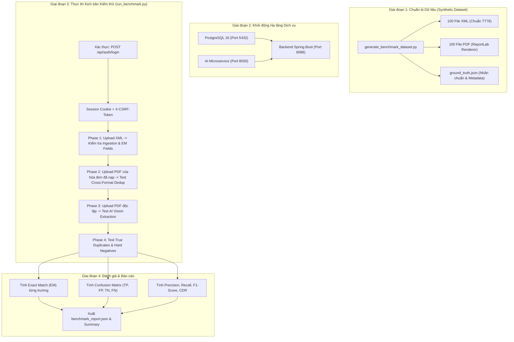

# TÀI LIỆU HƯỚNG DẪN BENCHMARK PIPELINE TIẾP NHẬN & ĐỐI SOÁT HÓA ĐƠN
### Hệ Thống Tự Động Hóa Quyết Toán & Kiểm Toán Chi Phí (Smart Expense)

---

## 1. MỤC TIÊU & Ý NGHĨA BÀI TEST BENCHMARK

Bài kiểm thử Benchmark được thiết kế nhằm đánh giá toàn diện năng lực của hệ thống xử lý hóa đơn tự động qua 2 trụ cột nghiệp vụ cốt lõi:

1. **Khả năng bóc tách & hiểu tài liệu đa phương thức (Document Extraction Benchmark)**:
   - **Hóa đơn điện tử XML (Chuẩn Thông tư 78/2021/TT-BTC)**: Đánh giá bộ bóc tách có cấu trúc (`InvoiceXmlParser`), khả năng đọc các node thẻ, xử lý định dạng tiền tệ và kiểm tra tính toàn vẹn của chữ ký điện tử số (`xmlDSig`).
   - **Hóa đơn tài liệu PDF**: Đánh giá năng lực của mô hình AI Vision (Google Gemini Multimodal / Heuristic Fallback Engine) trong việc nhận diện và trích xuất thông tin phi cấu trúc từ PDF một trang, nhiều trang (multi-page) và các trường hợp biên (corner cases).
2. **Khả năng phát hiện trùng lặp & gian lận tài chính (Deduplication Benchmark)**:
   - **Trùng lặp chéo định dạng (Cross-Format Deduplication: XML vs PDF)**: Doanh nghiệp thường nhận được cả file XML và file PDF thể hiện cho cùng một tờ hóa đơn. Hệ thống phải đảm bảo: Nếu đã nạp XML (hoặc PDF) trước đó, khi nhân viên nạp tiếp file PDF (hoặc XML) của cùng hóa đơn đó, hệ thống phải **ngay lập tức nhận diện và chặn tạo bản ghi mới** (`DUPLICATE_IDENTITY`), tránh việc thanh toán chi phí 2 lần.
   - **Trùng lặp nội dung tuyệt đối (True Duplicates)**: Cùng hoặc khác file nhưng trùng toàn bộ thông tin định danh nghiệp vụ.
   - **Khả năng phân biệt âm tính giả (Hard Negatives / Near Duplicates)**: Hai hóa đơn phát sinh cùng một nhà cung cấp, trong cùng một ngày, với tổng tiền hoàn toàn giống nhau nhưng **khác số hóa đơn**. Hệ thống phải thông minh để **không được báo trùng nhầm**, đảm bảo kế toán không bị gián đoạn công việc.

---

## 2. QUY TRÌNH THỰC THI BENCHMARK (EXECUTION WORKFLOW)



---

## 3. CÁC TRƯỜNG DỮ LIỆU & TIÊU CHÍ KIỂM TRA (WHAT IS CHECKED?)

Trong mỗi lượt nạp tài liệu, hệ thống và bộ runner sẽ kiểm tra nghiêm ngặt các tiêu chí sau:

### 3.1. Bộ 4 trường thông tin nghiệp vụ cốt lõi:
| STT | Trường thông tin | Khóa trong Ground Truth | Ý nghĩa nghiệp vụ | Tiêu chí đánh giá Khớp (Match) |
| :---: | :--- | :--- | :--- | :--- |
| **1** | **Số hóa đơn** | `invoice_number` | Số thứ tự hóa đơn do cơ quan thuế/nhà cung cấp cấp | Chuẩn hóa chuỗi (bỏ khoảng trắng, không phân biệt hoa thường) bằng nhau tuyệt đối. |
| **2** | **Mã số thuế bên bán** | `seller_tax_id` | Mã số thuế đơn vị phát hành (10 số hoặc 13 số chi nhánh) | Chuỗi MST khớp nhau 100%. |
| **3** | **Ngày lập hóa đơn** | `issue_date` | Ngày hóa đơn có hiệu lực pháp lý (YYYY-MM-DD) | Trùng khớp ngày, tháng, năm (`pred[:10] == truth[:10]`). |
| **4** | **Tổng tiền thanh toán** | `total_amount` | Số tiền cuối cùng doanh nghiệp phải chi trả (VND) | Sai số giá trị thực nghiệm $\le 1.0\text{ VND}$ (do làm tròn số học). |

### 3.2. Tiêu chí phát hiện trùng lặp (Deduplication Rules):
Hệ thống sử dụng bộ khóa định danh tổng hợp:
$$\text{IdentityKey} = \langle \text{Mã số thuế người bán}, \text{Ký hiệu mẫu số}, \text{Ký hiệu hóa đơn}, \text{Số hóa đơn} \rangle$$
* **Trùng chéo định dạng (Cross-Format)**: File XML nạp trước $\rightarrow$ ghi nhận thành công trạng thái `INGESTED`. File PDF của hóa đơn này nạp sau $\rightarrow$ AI bóc tách thông tin $\rightarrow$ hệ thống đối chiếu $\text{IdentityKey}$ $\rightarrow$ gắn cờ **`DUPLICATE_IDENTITY`** kèm ID tham chiếu của hóa đơn XML ban đầu.
* **Trùng lặp nội dung file**: Hai file giống hệt nhau về mã băm $\text{SHA-256}$ $\rightarrow$ hệ thống chặn ngay tại tầng lưu trữ và trả về trạng thái **`ALREADY_RECEIVED`**.
* **Hard Negative (Không được nhầm)**: Cùng người bán, ngày lập và số tiền, nhưng khác số hóa đơn $\rightarrow$ hệ thống **bắt buộc phải chấp nhận** và tạo hóa đơn mới độc lập (`INGESTED`).

---

## 4. CÔNG THỨC TOÁN HỌC & KIỂM TOÁN THỐNG KÊ

### 4.1. Tỷ lệ khớp chính xác trường thông tin (Exact Match - EM Rate)
Đối với mỗi trường dữ liệu $f \in \{\text{Số HĐ, MST bán, Ngày lập, Tổng tiền}\}$, trên tập $N$ tài liệu thử nghiệm:

$$EM_f = \frac{1}{N} \sum_{i=1}^{N} \mathbb{I}(\text{pred}_{i, f} = \text{truth}_{i, f}) \times 100\%$$

Trong đó $\mathbb{I}(\cdot)$ là hàm chỉ thị nhận giá trị $1$ nếu điều kiện thỏa mãn và $0$ nếu sai.

Đặc biệt với trường Tổng tiền thanh toán:
$$\mathbb{I}(\text{match}_{\text{amount}}) = \begin{cases} 1 & \text{khi } |\text{pred}_{\text{amount}} - \text{truth}_{\text{amount}}| \le 1.0 \text{ VND} \\ 0 & \text{ngược lại} \end{cases}$$

### 4.2. Độ chính xác tổng hợp (Overall Document Accuracy)
Một tài liệu được tính là trích xuất hoàn hảo khi và chỉ khi **tất cả các trường cốt lõi đều đúng**:

$$Acc_{\text{all\_fields}} = \frac{1}{N} \sum_{i=1}^{N} \left( \prod_{f \in \mathcal{F}} \mathbb{I}(\text{pred}_{i, f} = \text{truth}_{i, f}) \right) \times 100\%$$

---

### 4.3. Ma trận nhầm lẫn kiểm toán trùng lặp (Confusion Matrix)

| Thực tế \ Dự đoán của Hệ thống | Hệ thống BÁO TRÙNG (`DUPLICATE_IDENTITY` / `ALREADY_RECEIVED`) | Hệ thống KHÔNG BÁO TRÙNG (`INGESTED` / `OCR_REVIEW`) |
| :--- | :---: | :---: |
| **Thực tế LÀ HÓA ĐƠN TRÙNG** | **True Positive (TP)**<br>*(Chặn gian lận thành công)* | **False Negative (FN)**<br>*(Bỏ sót trùng lặp - Rủi ro thất thoát)* |
| **Thực tế LÀ HÓA ĐƠN HỢP LỆ (Không trùng)** | **False Positive (FP)**<br>*(Báo động giả - Gây tắc nghẽn kế toán)* | **True Negative (TN)**<br>*(Xử lý chuẩn xác hóa đơn hợp lệ)* |

#### Các chỉ số kiểm toán:
1. **Precision (Độ chuẩn xác / Tin cậy của cảnh báo trùng)**:
   Xác suất để một cảnh báo trùng lặp từ hệ thống thực sự là hóa đơn trùng:
   $$\text{Precision} = \frac{TP}{TP + FP}$$

2. **Recall (Độ nhạy / Tỷ lệ thu hồi gian lận)**:
   Khả năng phát hiện và bắt trọn tất cả các hành vi nộp trùng hóa đơn trong doanh nghiệp:
   $$\text{Recall} = \frac{TP}{TP + FN}$$

3. **F1-Score (Điểm số điều hòa)**:
   Đánh giá sự cân bằng giữa việc không bỏ sót gian lận và không làm phiền kế toán viên:
   $$F_1 = 2 \times \frac{\text{Precision} \times \text{Recall}}{\text{Precision} + \text{Recall}}$$

4. **Tỷ lệ nhận diện trùng lặp chéo định dạng (Cross-Format Detection Rate - CDR)**:
   $$CDR = \frac{\text{Số cặp (XML, PDF) cùng hóa đơn bị chặn trùng thành công}}{\text{Tổng số cặp (XML, PDF) đưa vào kiểm thử}} \times 100\%$$

---

## 5. HƯỚNG DẪN CÁC BƯỚC CHẠY BENCHMARK CHI TIẾT

### Bước 1: Khởi tạo Dataset mẫu (Chỉ cần chạy 1 lần)
Mở PowerShell tại thư mục gốc `invoice-system-main`:
```powershell
python generate_benchmark_dataset.py
```
> Lệnh này sẽ tạo ra 100 file XML tại `dataset/xml/`, 100 file PDF tại `dataset/pdf/` và bộ nhãn kiểm toán `dataset/ground_truth.json`.

---

### Bước 2: Chọn phương thức chạy Benchmark

#### Lựa chọn A: Chế độ DRY-RUN (Mô phỏng nội bộ - Cực nhanh, 1 giây)
Dùng khi bạn muốn kiểm tra ngay dataset, tính toán các chỉ số toán học Precision/Recall/F1 mà không cần bật cơ sở dữ liệu hay Spring Boot:
```powershell
python run_benchmark.py --mode dry-run
```

#### Lựa chọn B: Chế độ LIVE (Kiểm thử thực tế toàn bộ hệ thống qua REST API)
Dùng để kiểm thử hiệu năng và độ chính xác thực tế của Backend Java và Microservice AI:

1. **Đảm bảo PostgreSQL đang chạy** (cổng 5432).
2. **Khởi động AI Microservice** (PowerShell 1):
   ```powershell
   cd ai-service
   python -m uvicorn app.main:app --host 127.0.0.1 --port 8000
   ```
3. **Khởi động Backend Spring Boot** (PowerShell 2):
   ```powershell
   cd backend
   $env:APP_BOOTSTRAP_USERNAME = "accountant@example.com"
   $env:APP_BOOTSTRAP_PASSWORD = "Password@123456"
   $env:APP_BOOTSTRAP_TAX_CODE = "9999999999"
   $env:APP_BOOTSTRAP_TENANT_NAME = "Benchmark Tenant"
   mvn spring-boot:run
   ```
4. **Chạy Runner kiểm thử** (PowerShell 3):
   * *Kiểm thử nhanh 10 mẫu:*
     ```powershell
     python run_benchmark.py --mode live --sample 10
     ```
   * *Kiểm thử toàn diện 100 mẫu:*
     ```powershell
     python run_benchmark.py --mode live
     ```

---

## 6. ĐỌC VÀ PHÂN TÍCH KẾT QUẢ ĐẦU RA

Khi script kết thúc, một bảng kết quả trực quan sẽ hiển thị trên Terminal:
```text
============================================================
 TỔNG HỢP KẾT QUẢ BENCHMARK TOÀN DIỆN (LIVE BACKEND)
============================================================

1. KHẢ NĂNG ĐỌC VÀ TRÍCH XUẤT XML (PARSER BENCHMARK):
  • Tổng số tài liệu XML : 10
  • Thành công           : 10/10 (100.0%)
  • Exact Match - Số HĐ  : 10/10 (100.0%)
  • Exact Match - MST    : 10/10 (100.0%)
  • Exact Match - Ngày   : 10/10 (100.0%)
  • Exact Match - Tiền   : 10/10 (100.0%)

2. KHẢ NĂNG TRÍCH XUẤT PDF (AI / VISION BENCHMARK):
  • Tổng số tài liệu PDF : 10
  • Trích xuất thành công: 10/10 (100.0%)
  • Exact Match - Số HĐ  : 10/10 (100.0%)
  • Exact Match - MST    : 10/10 (100.0%)
  • Exact Match - Ngày   : 10/10 (100.0%)
  • Exact Match - Tiền   : 10/10 (100.0%)

3. KIỂM TOÁN TRÙNG LẶP CHÉO ĐỊNH DẠNG (CROSS-FORMAT: XML vs PDF):
  • Số cặp test chéo XML -> PDF     : 10
  • Số cặp chặn trùng thành công   : 10
  • Tỷ lệ phát hiện trùng chéo      : 100.00%
============================================================
Báo cáo chi tiết đã được lưu tại: benchmark_report.json
```

File [benchmark_report.json](file:///c:/Users/masoc/Projects/invoice-system-main/benchmark_report.json) được tạo ra có thể dùng để lưu trữ báo cáo kỹ thuật, phục vụ việc đánh giá năng lực nghiệm thu dự án hoặc tinh chỉnh mô hình Prompt Engineering của đội ngũ AI.
